# Example images, with the expected text beside what was read

Companion to `RESULTS.md`.  Same weights, nothing retrained.  Every image below is a real file under `results/images/`, so each number can be checked by eye.

## 1. Real line crops

One page per writer, 5 lines spread down it.  `expected` is the transcript typed when the page was collected.  Two readers are shown: *joint* is the checkpoint the report figures were taken on, *scratch* is the one the loader currently picks first.

### abhinav, page Abhinav01

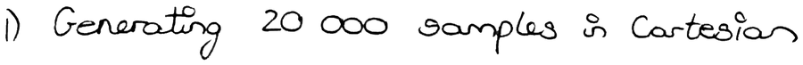

| | text | char %% |
|---|---|---|
| expected | `1) Generating 20 000 samples in Cartesian` | |
| read, joint | `1 Generating 20 000 samples in Cartesion` | 95.1 |
| read, scratch | `f peey a pes poed ' pepee ,` | 26.8 |

writer id on this crop: ink says **abhinav** at 100.0%, shape says **abhinav** at 100.0%

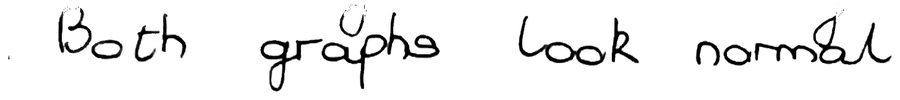

| | text | char %% |
|---|---|---|
| expected | `Both graphs look normal.` | |
| read, joint | `Both graphs look normal.` | 100.0 |
| read, scratch | `, ged pge eed pged` | 16.7 |

writer id on this crop: ink says **abhinav** at 100.0%, shape says **abhinav** at 100.0%

| | text | char %% |
|---|---|---|
| expected | `Correlation shows a nonlinear effect` | |
| read, joint | `Correlation shows a nonlinear effect` | 100.0 |
| read, scratch | `pepgee, ed o peee pped` | 19.4 |

writer id on this crop: ink says **abhinav** at 100.0%, shape says **abhinav** at 100.0%

| | text | char %% |
|---|---|---|
| expected | `end of the spectrum. Higher the` | |
| read, joint | `end of the spectrum Migher the` | 93.5 |
| read, scratch | `"ed of e, peee, pfe pe` | 38.7 |

writer id on this crop: ink says **abhinav** at 100.0%, shape says **abhinav** at 99.9%

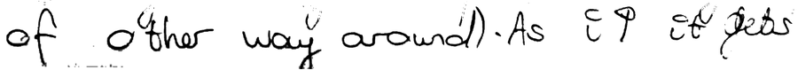

| | text | char %% |
|---|---|---|
| expected | `of other way around). As it gets pointier.` | |
| read, joint | `of other way around). As it gets pointier.` | 100.0 |
| read, scratch | `oy , e ey peee , f y of pe d` | 28.6 |

writer id on this crop: ink says **abhinav** at 100.0%, shape says **abhinav** at 99.4%

### dylan, page Dylan01

| | text | char %% |
|---|---|---|
| expected | `The input to this stage is a raw photo of` | |
| read, joint | `The input to this stage is a raw photo of` | 100.0 |
| read, scratch | `oy s s   , , ed et of` | 29.3 |

writer id on this crop: ink says **dylan** at 100.0%, shape says **dylan** at 95.6%

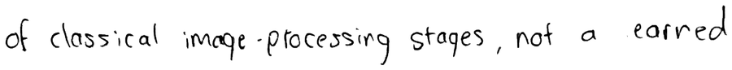

| | text | char %% |
|---|---|---|
| expected | `of classical image-processing stages, not a learned` | |
| read, joint | `of classical image-processing stages, not a learned` | 100.0 |
| read, scratch | `of ed pey y es , t  ped` | 29.4 |

writer id on this crop: ink says **dylan** at 100.0%, shape says **dylan** at 78.3%

| | text | char %% |
|---|---|---|
| expected | `into a "below" class and an "above" class, and` | |
| read, joint | `into a "below" class and an "above class, and` | 97.8 |
| read, scratch | `es , ,pes , es et  es es , et` | 28.3 |

writer id on this crop: ink says **dylan** at 100.0%, shape says **dylan** at 47.8%

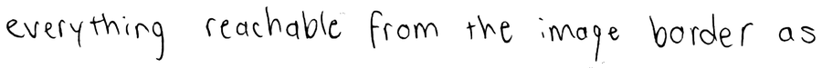

| | text | char %% |
|---|---|---|
| expected | `everything reachable from the image border as` | |
| read, joint | `everything reachable from the image border as` | 100.0 |
| read, scratch | `es ped pe  y ped ,` | 22.2 |

writer id on this crop: ink says **dylan** at 100.0%, shape says **dylan** at 92.5%

| | text | char %% |
|---|---|---|
| expected | `the background estimate and rescaling. The corrected` | |
| read, joint | `the background estimate and rescaling. The corrected` | 100.0 |
| read, scratch | `of peed ed pet pe,  pe d` | 21.2 |

writer id on this crop: ink says **dylan** at 100.0%, shape says **dylan** at 99.5%

### owen, page Owen01

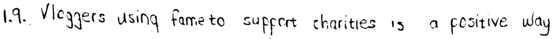

| | text | char %% |
|---|---|---|
| expected | `1.9. Vloggers using fame to support charities is a positive way` | |
| read, joint | `1.9. Vloggers using fame to support charities is a positive way` | 100.0 |
| read, scratch | ` ,s s ped a ee , , g y` | 22.2 |

writer id on this crop: ink says **owen** at 99.7%, shape says **owen** at 99.6%

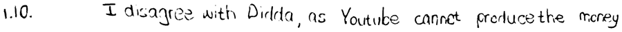

| | text | char %% |
|---|---|---|
| expected | `1.10. I disagree with Didda, as Youtube cannot produce the money` | |
| read, joint | `1.10. I disagree with Didda, as Youtube cannot produce the money` | 100.0 |
| read, scratch | `s . s s ed s ed ed pe ey` | 26.6 |

writer id on this crop: ink says **owen** at 99.1%, shape says **owen** at 99.5%

| | text | char %% |
|---|---|---|
| expected | `for a subscription, while Youtube offers a free, easily accessible` | |
| read, joint | `for a subscription, while Youtube offers a free, easily accessible` | 100.0 |
| read, scratch | `o , g d ed e pe , ey ee` | 25.8 |

writer id on this crop: ink says **owen** at 100.0%, shape says **owen** at 100.0%

| | text | char %% |
|---|---|---|
| expected | `while male activities are mostly sport.` | |
| read, joint | `while male activities are mostly sport.` | 100.0 |
| read, scratch | `o pee ges poey y ,` | 23.1 |

writer id on this crop: ink says **owen** at 100.0%, shape says **owen** at 100.0%

| | text | char %% |
|---|---|---|
| expected | `very little creative categories are viewed on Youtube.` | |
| read, joint | `very little creative categories are viewed on 'Youtube.` | 98.1 |
| read, scratch | `ey s s   d s ee .` | 20.4 |

writer id on this crop: ink says **owen** at 100.0%, shape says **owen** at 100.0%

### thiya, page Thiya01

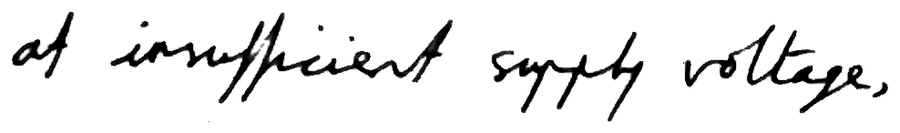

| | text | char %% |
|---|---|---|
| expected | `at insufficient supply voltage,` | |
| read, joint | `of insufficient suppty voltage .` | 83.9 |
| read, scratch | `oy igied pogey pege .` | 25.8 |

writer id on this crop: ink says **thiya** at 99.9%, shape says **thiya** at 95.3%

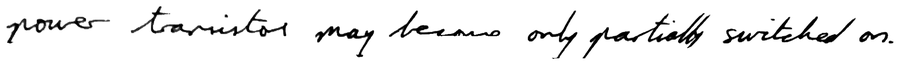

| | text | char %% |
|---|---|---|
| expected | `power transistor may become only partially switched on.` | |
| read, joint | `power transistor may become only partially switched on.` | 100.0 |
| read, scratch | `poe peoides pay e ay poheg padeed a .` | 34.5 |

writer id on this crop: ink says **thiya** at 100.0%, shape says **thiya** at 99.8%

| | text | char %% |
|---|---|---|
| expected | `above threshold but below recommended operating range.` | |
| read, joint | `above threshold but below recommended operating range.` | 100.0 |
| read, scratch | `agee , peley ot ehe poed plg pege ,` | 31.5 |

writer id on this crop: ink says **thiya** at 100.0%, shape says **thiya** at 96.1%

| | text | char %% |
|---|---|---|
| expected | `voltage range where the designer can't know whether the` | |
| read, joint | `voltage range where the designer can't know whether the` | 100.0 |
| read, scratch | `y pey ge , e go ad ee plete , he` | 30.9 |

writer id on this crop: ink says **thiya** at 100.0%, shape says **thiya** at 94.6%

| | text | char %% |
|---|---|---|
| expected | `v drop after startup` | |
| read, joint | `v drop after startup` | 100.0 |
| read, scratch | `o e age he.` | 25.0 |

writer id on this crop: ink says **thiya** at 99.2%, shape says **thiya** at 79.5%

### yeukita, page Yeukita01

| | text | char %% |
|---|---|---|
| expected | `single runs NEES is noisy, so you average over many Monte Carlo` | |
| read, joint | `single runs NEES is noisy, so you average over many Monte Carlo` | 100.0 |
| read, scratch | `ey es es , y s   ey es e.` | 23.8 |

writer id on this crop: ink says **yeukita** at 99.9%, shape says **yeukita** at 99.9%

| | text | char %% |
|---|---|---|
| expected | `overconfident (bad ANEES) - meaning it doesn't know how wrong it` | |
| read, joint | `overconfident (bad ANEES) - meaning it doesn't know how wrong it` | 100.0 |
| read, scratch | `eeed d , aey , es peey` | 18.8 |

writer id on this crop: ink says **yeukita** at 99.9%, shape says **yeukita** at 99.5%

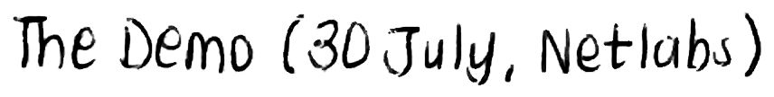

| | text | char %% |
|---|---|---|
| expected | `The Demo (30 July, Netlabs)` | |
| read, joint | `The Demo (30 July, Netlabs)` | 100.0 |
| read, scratch | `g e, o a , pege ,` | 25.9 |

writer id on this crop: ink says **yeukita** at 99.7%, shape says **yeukita** at 99.8%

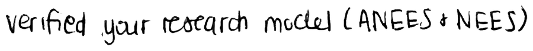

| | text | char %% |
|---|---|---|
| expected | `verified your research model (ANEES & NEES)` | |
| read, joint | `verified your research model (ANEES  NEES)` | 97.7 |
| read, scratch | `peged ps ped ed ee eed` | 23.3 |

writer id on this crop: ink says **yeukita** at 99.9%, shape says **yeukita** at 99.8%

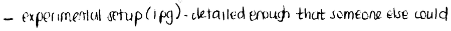

| | text | char %% |
|---|---|---|
| expected | `- experimental setup (1pg) - detailed enough that someone else could` | |
| read, joint | `- experimental setup (1pg) - detailed enough that someone else could` | 100.0 |
| read, scratch | `a pd ,eey d es ed` | 17.6 |

writer id on this crop: ink says **yeukita** at 100.0%, shape says **yeukita** at 100.0%

## 2. Real crops, all examples in one table

| writer | line | expected | read, joint | char % | read, scratch | char % | ink | shape |
|---|---|---|---|---|---|---|---|---|
| abhinav | 1 | `1) Generating 20 000 samples in Cartesian` | `1 Generating 20 000 samples in Cartesion` | 95.1 | `f peey a pes poed ' pepee ,` | 26.8 | abhinav 100.0% | abhinav 100.0% |
| abhinav | 7 | `Both graphs look normal.` | `Both graphs look normal.` | 100.0 | `, ged pge eed pged` | 16.7 | abhinav 100.0% | abhinav 100.0% |
| abhinav | 13 | `Correlation shows a nonlinear effect` | `Correlation shows a nonlinear effect` | 100.0 | `pepgee, ed o peee pped` | 19.4 | abhinav 100.0% | abhinav 100.0% |
| abhinav | 19 | `end of the spectrum. Higher the` | `end of the spectrum Migher the` | 93.5 | `"ed of e, peee, pfe pe` | 38.7 | abhinav 100.0% | abhinav 99.9% |
| abhinav | 26 | `of other way around). As it gets pointier.` | `of other way around). As it gets pointier.` | 100.0 | `oy , e ey peee , f y of pe d` | 28.6 | abhinav 100.0% | abhinav 99.4% |
| dylan | 1 | `The input to this stage is a raw photo of` | `The input to this stage is a raw photo of` | 100.0 | `oy s s   , , ed et of` | 29.3 | dylan 100.0% | dylan 95.6% |
| dylan | 6 | `of classical image-processing stages, not a learned` | `of classical image-processing stages, not a learned` | 100.0 | `of ed pey y es , t  ped` | 29.4 | dylan 100.0% | dylan 78.3% |
| dylan | 12 | `into a "below" class and an "above" class, and` | `into a "below" class and an "above class, and` | 97.8 | `es , ,pes , es et  es es , et` | 28.3 | dylan 100.0% | dylan 47.8% |
| dylan | 18 | `everything reachable from the image border as` | `everything reachable from the image border as` | 100.0 | `es ped pe  y ped ,` | 22.2 | dylan 100.0% | dylan 92.5% |
| dylan | 24 | `the background estimate and rescaling. The corrected` | `the background estimate and rescaling. The corrected` | 100.0 | `of peed ed pet pe,  pe d` | 21.2 | dylan 100.0% | dylan 99.5% |
| owen | 1 | `1.9. Vloggers using fame to support charities is a positive way` | `1.9. Vloggers using fame to support charities is a positive way` | 100.0 | ` ,s s ped a ee , , g y` | 22.2 | owen 99.7% | owen 99.6% |
| owen | 5 | `1.10. I disagree with Didda, as Youtube cannot produce the money` | `1.10. I disagree with Didda, as Youtube cannot produce the money` | 100.0 | `s . s s ed s ed ed pe ey` | 26.6 | owen 99.1% | owen 99.5% |
| owen | 10 | `for a subscription, while Youtube offers a free, easily accessible` | `for a subscription, while Youtube offers a free, easily accessible` | 100.0 | `o , g d ed e pe , ey ee` | 25.8 | owen 100.0% | owen 100.0% |
| owen | 15 | `while male activities are mostly sport.` | `while male activities are mostly sport.` | 100.0 | `o pee ges poey y ,` | 23.1 | owen 100.0% | owen 100.0% |
| owen | 20 | `very little creative categories are viewed on Youtube.` | `very little creative categories are viewed on 'Youtube.` | 98.1 | `ey s s   d s ee .` | 20.4 | owen 100.0% | owen 100.0% |
| thiya | 1 | `at insufficient supply voltage,` | `of insufficient suppty voltage .` | 83.9 | `oy igied pogey pege .` | 25.8 | thiya 99.9% | thiya 95.3% |
| thiya | 4 | `power transistor may become only partially switched on.` | `power transistor may become only partially switched on.` | 100.0 | `poe peoides pay e ay poheg padeed a .` | 34.5 | thiya 100.0% | thiya 99.8% |
| thiya | 8 | `above threshold but below recommended operating range.` | `above threshold but below recommended operating range.` | 100.0 | `agee , peley ot ehe poed plg pege ,` | 31.5 | thiya 100.0% | thiya 96.1% |
| thiya | 12 | `voltage range where the designer can't know whether the` | `voltage range where the designer can't know whether the` | 100.0 | `y pey ge , e go ad ee plete , he` | 30.9 | thiya 100.0% | thiya 94.6% |
| thiya | 16 | `v drop after startup` | `v drop after startup` | 100.0 | `o e age he.` | 25.0 | thiya 99.2% | thiya 79.5% |
| yeukita | 1 | `single runs NEES is noisy, so you average over many Monte Carlo` | `single runs NEES is noisy, so you average over many Monte Carlo` | 100.0 | `ey es es , y s   ey es e.` | 23.8 | yeukita 99.9% | yeukita 99.9% |
| yeukita | 7 | `overconfident (bad ANEES) - meaning it doesn't know how wrong it` | `overconfident (bad ANEES) - meaning it doesn't know how wrong it` | 100.0 | `eeed d , aey , es peey` | 18.8 | yeukita 99.9% | yeukita 99.5% |
| yeukita | 13 | `The Demo (30 July, Netlabs)` | `The Demo (30 July, Netlabs)` | 100.0 | `g e, o a , pege ,` | 25.9 | yeukita 99.7% | yeukita 99.8% |
| yeukita | 19 | `verified your research model (ANEES & NEES)` | `verified your research model (ANEES  NEES)` | 97.7 | `peged ps ped ed ee eed` | 23.3 | yeukita 99.9% | yeukita 99.8% |
| yeukita | 26 | `- experimental setup (1pg) - detailed enough that someone else could` | `- experimental setup (1pg) - detailed enough that someone else could` | 100.0 | `a pd ,eey d es ed` | 17.6 | yeukita 100.0% | yeukita 100.0% |

## 3. Synthesised lines

Target text `the gantry writes this`, best of 6, one seed, rendered at 18 px/mm then read back.  The same two networks score the search, so these are not an independent test of it.

### 150

| | |
|---|---|
| target | `the gantry writes this` |
| read back | `the gantry urites this` |
| char accuracy | 95.5% |
| word accuracy | 75.0% |
| writer predicted | 150 at 86.5% |
| confidence in the true writer | 86.5% |
| strokes / time | 39 / 10.3 s |

### 151

| | |
|---|---|
| target | `the gantry writes this` |
| read back | `tc gontry arites toolis` |
| char accuracy | 68.2% |
| word accuracy | 0.0% |
| writer predicted | 151 at 50.7% |
| confidence in the true writer | 50.7% |
| strokes / time | 36 / 15.1 s |

### 152

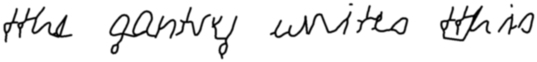

| | |
|---|---|
| target | `the gantry writes this` |
| read back | `the gantry unites this` |
| char accuracy | 90.9% |
| word accuracy | 75.0% |
| writer predicted | 152 at 81.9% |
| confidence in the true writer | 81.9% |
| strokes / time | 40 / 11.4 s |

### 153

| | |
|---|---|
| target | `the gantry writes this` |
| read back | `take anty triteo Nio` |
| char accuracy | 59.1% |
| word accuracy | 0.0% |
| writer predicted | 153 at 47.1% |
| confidence in the true writer | 47.1% |
| strokes / time | 40 / 12.0 s |

### 384

| | |
|---|---|
| target | `the gantry writes this` |
| read back | `the gantry wites this` |
| char accuracy | 95.5% |
| word accuracy | 75.0% |
| writer predicted | 384 at 99.4% |
| confidence in the true writer | 99.4% |
| strokes / time | 34 / 14.0 s |

### 551

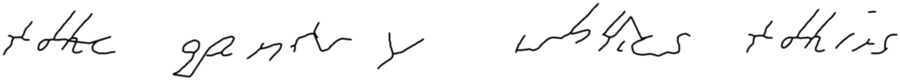

| | |
|---|---|
| target | `the gantry writes this` |
| read back | `takc gete y whies tohirs` |
| char accuracy | 50.0% |
| word accuracy | 0.0% |
| writer predicted | 551 at 71.6% |
| confidence in the true writer | 71.6% |
| strokes / time | 38 / 20.0 s |

### 552

| | |
|---|---|
| target | `the gantry writes this` |
| read back | `the gentry wites this` |
| char accuracy | 90.9% |
| word accuracy | 50.0% |
| writer predicted | 552 at 58.8% |
| confidence in the true writer | 58.8% |
| strokes / time | 32 / 10.9 s |

### 588

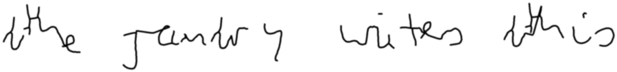

| | |
|---|---|
| target | `the gantry writes this` |
| read back | `the runtery wites ahis` |
| char accuracy | 77.3% |
| word accuracy | 25.0% |
| writer predicted | 588 at 65.9% |
| confidence in the true writer | 65.9% |
| strokes / time | 30 / 13.6 s |

### abhinav

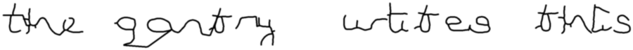

| | |
|---|---|
| target | `the gantry writes this` |
| read back | `the gontry urtites this` |
| char accuracy | 86.4% |
| word accuracy | 50.0% |
| writer predicted | abhinav at 99.5% |
| confidence in the true writer | 99.5% |
| strokes / time | 43 / 13.3 s |

### dylan

| | |
|---|---|
| target | `the gantry writes this` |
| read back | `the y antry writ is this` |
| char accuracy | 81.8% |
| word accuracy | 50.0% |
| writer predicted | dylan at 82.0% |
| confidence in the true writer | 82.0% |
| strokes / time | 31 / 11.1 s |

### owen

| | |
|---|---|
| target | `the gantry writes this` |
| read back | `the gantry wites this` |
| char accuracy | 95.5% |
| word accuracy | 75.0% |
| writer predicted | owen at 98.8% |
| confidence in the true writer | 98.8% |
| strokes / time | 36 / 10.8 s |

### thiya

| | |
|---|---|
| target | `the gantry writes this` |
| read back | `thee gantry unite the` |
| char accuracy | 72.7% |
| word accuracy | 25.0% |
| writer predicted | thiya at 94.0% |
| confidence in the true writer | 94.0% |
| strokes / time | 16 / 13.0 s |

### yeukita

| | |
|---|---|
| target | `the gantry writes this` |
| read back | `the gastery wites this` |
| char accuracy | 86.4% |
| word accuracy | 50.0% |
| writer predicted | yeukita at 86.3% |
| confidence in the true writer | 86.3% |
| strokes / time | 27 / 9.9 s |

## 4. Synthesised lines, all in one table

| writer | target | read back | char % | word % | predicted | conf % | true conf % | strokes | s |
|---|---|---|---|---|---|---|---|---|---|
| 150 | `the gantry writes this` | `the gantry urites this` | 95.5 | 75.0 | 150 | 86.5 | 86.5 | 39 | 10.3 |
| 151 | `the gantry writes this` | `tc gontry arites toolis` | 68.2 | 0.0 | 151 | 50.7 | 50.7 | 36 | 15.1 |
| 152 | `the gantry writes this` | `the gantry unites this` | 90.9 | 75.0 | 152 | 81.9 | 81.9 | 40 | 11.4 |
| 153 | `the gantry writes this` | `take anty triteo Nio` | 59.1 | 0.0 | 153 | 47.1 | 47.1 | 40 | 12.0 |
| 384 | `the gantry writes this` | `the gantry wites this` | 95.5 | 75.0 | 384 | 99.4 | 99.4 | 34 | 14.0 |
| 551 | `the gantry writes this` | `takc gete y whies tohirs` | 50.0 | 0.0 | 551 | 71.6 | 71.6 | 38 | 20.0 |
| 552 | `the gantry writes this` | `the gentry wites this` | 90.9 | 50.0 | 552 | 58.8 | 58.8 | 32 | 10.9 |
| 588 | `the gantry writes this` | `the runtery wites ahis` | 77.3 | 25.0 | 588 | 65.9 | 65.9 | 30 | 13.6 |
| abhinav | `the gantry writes this` | `the gontry urtites this` | 86.4 | 50.0 | abhinav | 99.5 | 99.5 | 43 | 13.3 |
| dylan | `the gantry writes this` | `the y antry writ is this` | 81.8 | 50.0 | dylan | 82.0 | 82.0 | 31 | 11.1 |
| owen | `the gantry writes this` | `the gantry wites this` | 95.5 | 75.0 | owen | 98.8 | 98.8 | 36 | 10.8 |
| thiya | `the gantry writes this` | `thee gantry unite the` | 72.7 | 25.0 | thiya | 94.0 | 94.0 | 16 | 13.0 |
| yeukita | `the gantry writes this` | `the gastery wites this` | 86.4 | 50.0 | yeukita | 86.3 | 86.3 | 27 | 9.9 |
